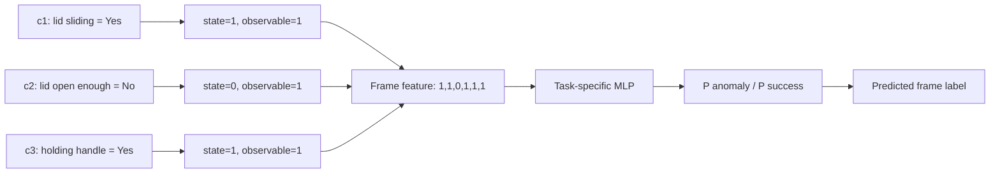
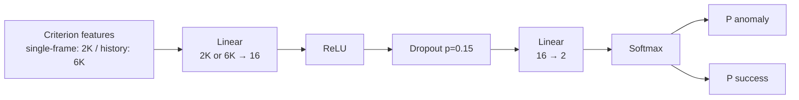
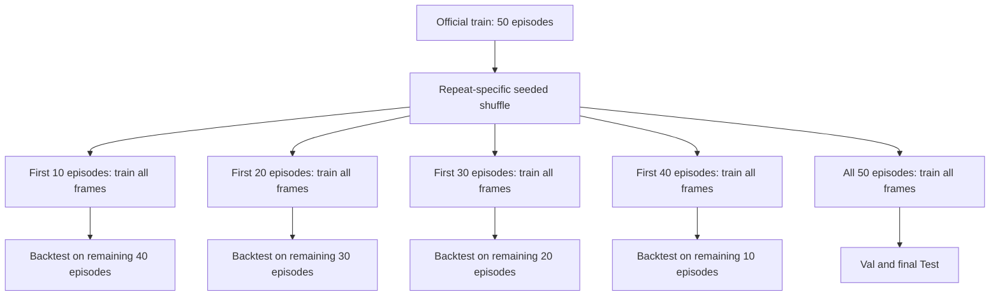

# CRIA 逐帧 Criterion-to-Anomaly 黑盒学习实验报告

## 1. 实验目标

本实验以一帧中各个 Criterion 的 Judgment（`Yes=1`、`No=0`、`Unknown=-1`）作为模型输入，以同一帧的 `frame_label`（`0=anomaly`、`1=success`）作为训练监督，学习输出该帧属于 `anomaly` 或 `success` 的概率与类别。实验首先建立只使用当前帧 Judgment 的单帧基线，再比较 10 帧、30 帧和完整因果历史窗口；模型不读取图像、动作、Graph、人工组合规则或 `episode_label`。

以 `open_box2` 的某一帧为例，该任务有三个 Criterion。若这一帧的 Judgment 为 `[1, 0, 1]`，对应的 `frame_label` 为 `0`，则训练样本可概括为：

```text
输入：[c1=Yes, c2=No, c3=Yes]
监督：frame_label=0（anomaly）
模型输出：P(anomaly), P(success)，并选择概率较高者作为该帧的预测类别
```

也就是说，基本学习单元为帧：

$$
\mathbf{x}_{e,t}=\operatorname{Encode}(J_{e,t}^{(1)},\ldots,J_{e,t}^{(K)}),
\qquad y_{e,t}=\text{frame\_label}_{e,t}
$$

其中，$e$ 表示 episode，$t$ 表示零基帧索引，$K$ 是该任务实际使用的 Criterion 数量。标签定义为：

- `0`：`anomaly`
- `1`：`success`（当前帧正常）

这里的 `success` 是 CRIA `frame_label=1` 的名称，不等同于整条 episode 已完成最终任务。

## 2. 实验结果

### 2.1 单帧预测方法

单帧方法只使用第 $t$ 帧的 Criterion Judgment 预测同一帧的 `frame_label`，不使用之前或之后的 Judgment。以下先报告不同训练 episode 数量下的剩余集回测，再报告使用全部 50 个训练 episode 得到的最终验证与测试结果。

**不同训练 episode 数量的剩余集回测**

下表报告 5 次不同 episode 抽样的 remaining-train Macro-F1，格式为 `mean ± population std`。

| Task | 10 episodes | 20 episodes | 30 episodes | 40 episodes |
|---|---:|---:|---:|---:|
| `open_box2` | 0.756 ± 0.022 | 0.752 ± 0.030 | 0.741 ± 0.053 | 0.752 ± 0.078 |
| `insert_plug_2` | 0.425 ± 0.028 | 0.395 ± 0.015 | 0.391 ± 0.019 | 0.384 ± 0.037 |
| `pushi` | 0.841 ± 0.020 | 0.845 ± 0.010 | 0.847 ± 0.011 | 0.833 ± 0.038 |
| `press_switch2` | 0.608 ± 0.022 | 0.591 ± 0.032 | 0.598 ± 0.057 | 0.555 ± 0.050 |
| `wipe_board` | 0.705 ± 0.015 | 0.713 ± 0.016 | 0.708 ± 0.043 | 0.678 ± 0.090 |

指标含义：

- remaining-train 回测：用前 $N$ 条 episode 训练所有帧，再在同一随机排列中剩余的 train episode 上评估，剩余集大小为 $50-N$。
- Macro-F1：对 anomaly 与 success 两类分别计算 F1 后取算术平均，不按帧数加权，因此对少数类（anomaly，约 19%）更敏感；逐帧 Accuracy 在类别不平衡时会明显偏高。
- `mean ± population std`：5 次 repeat 的算术均值与总体标准差（标准差分母为 $N=5$）。

50 条训练 episode 时没有剩余 train episode，因而不定义 remaining-train backtest。不同列的回测集合大小不同，所以数值不应被简单解释为严格的学习曲线；它主要用于观察不同小样本集合的敏感性。

**最终验证与测试结果**

下表使用每次 repeat 的全部 50 个训练 episode。格式仍为 `mean ± population std`。Val 在 10 条 val episode 上评估，Test 在 15 条 test episode 上评估。

| Task | Val Accuracy | Val Macro-F1 | Test Accuracy | Test Macro-F1 | Test episode-macro Accuracy |
|---|---:|---:|---:|---:|---:|
| `open_box2` | 0.844 ± 0.000 | 0.677 ± 0.000 | **0.979 ± 0.000** | **0.942 ± 0.000** | 0.974 ± 0.000 |
| `insert_plug_2` | 0.400 ± 0.000 | 0.384 ± 0.001 | 0.490 ± 0.000 | 0.483 ± 0.000 | 0.446 ± 0.000 |
| `pushi` | **0.896 ± 0.001** | **0.847 ± 0.002** | 0.897 ± 0.000 | 0.792 ± 0.000 | 0.898 ± 0.000 |
| `press_switch2` | 0.696 ± 0.000 | 0.557 ± 0.000 | 0.706 ± 0.000 | 0.526 ± 0.000 | 0.717 ± 0.000 |
| `wipe_board` | 0.856 ± 0.000 | 0.628 ± 0.000 | 0.875 ± 0.000 | 0.778 ± 0.000 | 0.871 ± 0.000 |

指标含义：

- Accuracy：全部帧中预测正确的比例，在 anomaly/success 约 19%/81% 的不平衡下会偏向多数类。
- Macro-F1：anomaly 与 success 两类 F1 的宏平均，反映少数类的识别质量。
- episode-macro Accuracy：先在每条 episode 内计算帧准确率，再对 episode 等权平均，避免长 episode 在该指标中占据过大权重。

### 2.2 历史预测方法

单帧模型无法表达 Criterion 的“持续”“先后”和“重叠”等时序关系，因此进一步把输入扩展为同一 episode 内的因果窗口：

$$
\mathbf{x}_{e,t}^{(W)}=\operatorname{Encode}(J_{e,[t-W+1,t]}^{(1)},\ldots,J_{e,[t-W+1,t]}^{(K)}),
\qquad y_{e,t}=\text{frame\_label}_{e,t}
$$

实验比较 10 帧、30 帧和完整历史 $[0,t]$。实现位于 `history_window_experiment.py`，复用单帧实验的数据加载、MLP 训练、episode 级抽样、评估和统计汇总，仅替换输入编码。每个 Criterion 使用 6 个特征：

| 特征 | 定义 |
|---|---|
| `state` | 第 $t$ 帧 Judgment，Unknown 记为 0 |
| `observable` | 第 $t$ 帧 Judgment 是否已知 |
| `yes_ratio` | 因果窗口内 Yes 帧占比 |
| `yes_ever` | 因果窗口内是否出现过 Yes |
| `since_last_yes_norm` | $(t-\text{最近一次Yes})/\text{窗口长度}$，尚未出现 Yes 时为 1 |
| `unknown_ratio` | 因果窗口内 Unknown 帧占比 |

输入维度从单帧基线的 $2K$ 变为 $6K$，网络仍为单隐层 16 维 MLP。每条 episode 从自己的第 0 帧重新计算历史，绝不跨 episode 拼接；第 $t$ 帧不读取未来 Judgment。`frame_label`、`episode_label` 及任何标签派生统计量均不进入输入。

### 2.3 单帧预测与历史预测结果对比

最终 Test Macro-F1 如下，历史窗口结果为 5 次 repeat 的 `mean ± population std`：

| Task | 单帧基线 | 10 帧历史 | 30 帧历史 | 完整历史 |
|---|---:|---:|---:|---:|
| `open_box2` | 0.942 | 0.942 ± 0.000 | 0.947 ± 0.006 | **0.948 ± 0.008** |
| `insert_plug_2` | 0.483 | 0.483 ± 0.000 | 0.483 ± 0.000 | 0.483 ± 0.000 |
| `pushi` | 0.792 | 0.792 ± 0.000 | 0.805 ± 0.005 | **0.848 ± 0.000** |
| `press_switch2` | 0.526 | 0.563 ± 0.005 | 0.647 ± 0.011 | **0.778 ± 0.026** |
| `wipe_board` | 0.778 | 0.782 ± 0.002 | 0.815 ± 0.004 | **0.916 ± 0.000** |

对应的最终 Test Accuracy：

| Task | 单帧基线 | 10 帧历史 | 30 帧历史 | 完整历史 |
|---|---:|---:|---:|---:|
| `open_box2` | 0.979 | 0.979 | 0.981 | **0.982** |
| `insert_plug_2` | 0.490 | 0.490 | 0.490 | 0.490 |
| `pushi` | 0.897 | 0.898 | 0.905 | **0.921** |
| `press_switch2` | 0.706 | 0.732 | 0.789 | **0.853** |
| `wipe_board` | 0.875 | 0.876 | 0.896 | **0.958** |

### 2.4 单帧与历史方法结果分析

- `press_switch2` 和 `wipe_board` 从历史信息中获益最大。完整历史相对单帧基线的 Test Macro-F1 分别提高约 0.252 和 0.138，说明事件先后与持续状态很重要。
- `pushi` 的完整历史提高约 0.056；30 帧窗口只提高约 0.013，表明较长的任务进度信息更有价值。
- `open_box2` 仅小幅提升，说明单帧 Criterion 已具有较强区分能力。
- `insert_plug_2` 在所有窗口下完全不变，说明其主要瓶颈并非历史不足，更可能是 Criterion 与逐帧标签语义不一致，或输入状态组合本身不可分。
- 10 帧窗口整体接近单帧基线，30 帧开始出现收益，完整历史在除 `insert_plug_2` 外的 4 个任务上取得最优结果。
- 小样本回测的标准差随剩余集缩小可能增大，例如 `wipe_board` 的 40-episode 训练设置；这说明单次抽样结果不足以代表稳定性能。
- 最终重复结果方差接近 0，并不代表小数据抽样稳定，而是因为各 repeat 在 50 条时使用相同训练 episode，且简单离散输入最终产生近似相同决策。

历史实验输出为 `outputs/history_window_backtest_results.json`、`outputs/history_window_predictions.json` 与 `outputs/<task>_history_w<window>_model_repeat_<NN>.pt`。

## 3. 数据来源与严格逐帧对齐

### 3.1 输入文件

- Criterion Judgment：`inputs/criterionANDjudgment/*.json`
- 逐帧标签：`inputs/frameAnomalyLabels/*.json`
- 标签原始来源：`E:/DenoteDatabase/CRIA/CRIA` 对应任务 Parquet 中的 `frame_label`

数据加载器先按顶层 `task` 配对两类 JSON，再检查：

1. 两侧 task 完全一致；
2. episode ID 集合完全一致；
3. 同一 episode 的 split 一致；
4. Criterion Judgment、`frame_labels` 与 `frame_count` 长度一致；
5. Judgment 只包含 `-1/0/1`（本实验的实际数据中只出现 `0/1`，见 5.1）；
6. `frame_label` 只包含 `0/1`。

因此训练样本是严格的一帧对一帧：

$$
(J_{e,t}^{(1)},\ldots,J_{e,t}^{(K)})\longrightarrow y_{e,t}
$$

不会将第 $t$ 帧的 Criterion 与其他帧的标签配对。

### 3.2 数据规模

| Task | Train episodes / frames | Val episodes / frames | Test episodes / frames | 总帧数 |
|---|---:|---:|---:|---:|
| `articulated/open_box2` | 50 / 38,299 | 10 / 7,542 | 15 / 11,702 | 57,543 |
| `insert/insert_plug_2` | 50 / 29,128 | 10 / 5,107 | 15 / 9,210 | 43,445 |
| `path/pushi` | 50 / 49,109 | 10 / 9,953 | 15 / 13,891 | 72,953 |
| `press/press_switch2` | 50 / 19,683 | 10 / 4,149 | 15 / 6,168 | 30,000 |
| `wipe/wipe_board` | 50 / 29,789 | 10 / 5,619 | 15 / 8,501 | 43,909 |
| **合计** | **250 / 166,008** | **50 / 32,370** | **75 / 49,472** | **247,850** |

标签分布：全部 247,850 帧中 `1`（success，正常帧）200,827 帧（约 81%），`0`（anomaly，异常帧）47,023 帧（约 19%）。

> 注：五个任务独立建模，不会把不同任务的 Criterion 特征混在同一个模型中。实验总帧数由输出程序校验为 247,850。

## 4. 实际使用的 Criterion

本节只列出实际进入 `blackbox_experiment.py` 的 Criterion，来源是 `inputs/criterionANDjudgment/`。不列出未参与本实验的“简易版”、候选版或其他设计版本。

### 4.1 `articulated/open_box2`

| ID | 实际 Criterion |
|---|---|
| `c1` | Is the box lid currently sliding leftward? |
| `c2` | Is the box lid open enough to expose the interior? |
| `c3` | Is the gripper securely holding the lid handle? |

### 4.2 `insert/insert_plug_2`

| ID | 实际 Criterion |
|---|---|
| `c1` | Are the plug prongs aligned with the socket openings? |
| `c2` | Is the plug blocked during an insertion attempt? |
| `c3` | Is the plug advancing into the socket? |
| `c4` | Is the plug fully inserted into the socket? |

### 4.3 `path/pushi`

| ID | 实际 Criterion |
|---|---|
| `c1` | Is the gripper securely holding the block? |
| `c2` | Is the block jammed against the track boundary? |
| `c3` | Is the block moving along the constrained track? |
| `c4` | Has the block reached the yellow target area? |

### 4.4 `press/press_switch2`

| ID | 实际 Criterion |
|---|---|
| `c1` | Is the gripper pressing the red button? |
| `c2` | Is the red button fully depressed? |
| `c3` | Is the LED strip illuminated? |

### 4.5 `wipe/wipe_board`

| ID | 实际 Criterion |
|---|---|
| `c1` | Is the eraser sliding along the dirt? |
| `c2` | Have the markings on the whiteboard been erased? |
| `c3` | Is the eraser in contact with the board while erasing? |

## 5. Criterion 编码与到 anomaly 的映射

### 5.1 Judgment 编码

每个 Criterion 的原始 Judgment 都编码成 `state` 和 `observable` 两个通道：

| Judgment | 含义 | `state` | `observable` |
|---:|---|---:|---:|
| `0` | No | 0 | 1 |
| `1` | Yes | 1 | 1 |
| `-1` | Unknown | 0 | 0 |

编码设计上支持 `-1`（Unknown），但本实验的实际数据中不存在 `-1`：全部 Judgment 只有 `0`（683,935 个）和 `1`（176,013 个）。因此 `observable` 掩码恒为 1，模型输入等效于 $K$ 维 0/1 特征；掩码通道仅为兼容将来可能出现 Unknown 的数据而保留。

在单帧预测方法中，如果任务有 $K$ 个 Criterion，模型输入维度就是 $2K$：

$$
\mathbf{x}_{e,t}=[s_1,m_1,s_2,m_2,\ldots,s_K,m_K]
$$

其中 $s_k$ 是状态，$m_k$ 是可观测掩码。在本实验数据中 $m_k$ 恒为 1。

### 5.2 `open_box2` 单帧示例

假设某一帧的真实 Judgment 为：

| Criterion | Judgment | 编码 |
|---|---:|---|
| `c1` lid sliding leftward | `1` | `[1, 1]` |
| `c2` lid open enough | `0` | `[0, 1]` |
| `c3` gripper holding handle | `1` | `[1, 1]` |

则该帧输入为：

$$
\mathbf{x}_{e,t}=[1,1,\;0,1,\;1,1]
$$

同一帧的监督可能为：

$$
y_{e,t}=0=\text{anomaly}
$$

示意流程：



模型并没有预先写入“`c2=0` 必然异常”之类的规则。它通过大量逐帧样本和 `frame_label` 监督学习非线性映射：

$$
f_\theta:\{0,1\}^{2K}\rightarrow [P(\text{anomaly}),P(\text{success})]
$$

因此，以上只是输入编码示例，不是人工定义的判定规则。

## 6. 单帧与历史预测的网络结构

单帧方法和历史方法都为每个任务训练一个独立的小型 MLP，二者使用相同的隐藏层和输出层，区别只在输入编码：单帧方法输入维度为 $2K$，历史方法输入维度为 $6K$。



网络计算为：

$$
\mathbf{h}=\operatorname{Dropout}(\operatorname{ReLU}(W_1\mathbf{x}+b_1),0.15)
$$

$$
\mathbf{p}=\operatorname{Softmax}(W_2\mathbf{h}+b_2)
$$

默认设置：

| 项目 | 设置 |
|---|---|
| 隐藏层 | 1 层，16 维 |
| 激活 | ReLU |
| Dropout | 0.15 |
| 输出类别 | 2：anomaly、success |
| 损失 | 带类别权重的 Cross-Entropy |
| 优化器 | AdamW |
| 学习率 | 0.01 |
| Weight decay | `1e-3` |
| Epoch | 100 |
| 训练方式 | Full batch |

类别权重按当前训练帧中的类别频次计算，以降低 anomaly/success 数量不均衡（约 19%/81%）的影响。

单帧模型的第 $t$ 帧预测只依赖该帧 Judgment；历史模型额外使用同一 episode 内截至 $t$ 的因果 Judgment 统计。两种模型都不读取未来帧，也都不使用 RNN 或 Transformer。

## 7. 滚动抽样与无泄漏回测

虽然学习和预测单位是 frame，但数据划分单位必须是完整 episode。同一 episode 的帧具有强时间相关性；如果随机按帧切分，同一轨迹的相邻帧会同时进入训练和回测，导致数据泄漏和虚高指标。



默认执行 5 次独立重复，repeat seed 为：

```text
42, 1042, 2042, 3042, 4042
```

每次 repeat 都重新排列 50 个训练 episode。因此对于相同训练规模，例如 10 条 episode，会得到 5 个不同的训练子集。报告保留每次抽中的 episode ID、剩余 episode ID、模型 seed、指标、预测和模型。

需要注意：每个 repeat 内的 `10/20/30/40/50` 是同一随机排列的嵌套前缀；不同 repeat 之间才是不同集合。50 条时所有 repeat 使用相同的完整训练集，因此最终测试方差通常接近 0。

## 8. 当前限制

1. 第 2 节已比较单帧与聚合历史特征，但尚未尝试 GRU、1D-CNN 等序列模型，也未系统搜索更多窗口长度和历史统计。
2. Full-batch 训练适合当前规模，但不适合大规模扩展。
3. 同一任务中 Criterion 状态组合种类有限，模型可能退化成组合查表。
4. 最终全量训练的 5 次 repeat 只改变模型随机性，不改变训练 episode 集合；若需更可靠的最终泛化方差，应增加多组 episode-level cross-validation 或重新定义多组 train/test split。
5. `remaining-train` 在不同训练规模下对应不同大小、不同构成的回测集，不应代替固定 test 的最终比较。

## Appendix A. 评估指标与结果文件

主要指标：

- frame Accuracy
- frame Macro-F1
- 每类 Precision、Recall、F1、Support
- Confusion Matrix
- episode-macro Accuracy

各指标定义见 2.1；历史方法沿用相同的评估指标。

输出目录为 `outputs/`：

| 文件 | 内容 |
|---|---|
| `frame_rolling_backtest_results.json` | 每个任务、repeat、抽样规模的 episode ID、指标与汇总统计 |
| `frame_predictions.json` | 所有 repeat 的 val/test 逐帧真值、预测与概率 |
| `<task>_frame_model_repeat_<NN>.pt` | 每个任务每次 repeat 的单帧模型、特征定义、seed 和训练 episode 顺序 |
| `history_window_backtest_results.json` | 历史方法各任务、窗口和 repeat 的指标与汇总统计 |
| `history_window_predictions.json` | 历史方法所有窗口和 repeat 的 val/test 逐帧预测 |
| `<task>_history_w<window>_model_repeat_<NN>.pt` | 每个任务、历史窗口和 repeat 的历史模型 |

旧的 `rolling_*.json` 和不带 `repeat` 的模型属于先前轨迹级或单次实验，不是本报告结果。

## Appendix B. 运行方式

### B.1 环境依赖

需要 Python 3，并安装：

```bash
pip install numpy torch
```

### B.2 使用默认配置运行

在实验目录运行：

```bash
cd D:\RewardModel\criterion2outcomeSetup1\experiment-CRIA-blackbox-ML
python blackbox_experiment.py
```

默认等价于：

```bash
python blackbox_experiment.py --train-steps 10,20,30,40,50 --repeats 5 --hidden-dim 16 --epochs 100 --learning-rate 0.01 --seed 42
```

### B.3 运行历史窗口实验

默认同时运行 10 帧、30 帧和完整因果历史窗口：

```bash
python history_window_experiment.py
```

完整命令为：

```bash
python history_window_experiment.py --windows 10,30,full --train-steps 10,20,30,40,50 --repeats 5 --hidden-dim 16 --epochs 100 --learning-rate 0.01 --seed 42
```

`--windows` 接受逗号分隔的正整数和 `full`，例如 `--windows 5,15,60,full`。整数 $N$ 表示只使用同一 episode 的 $[t-N+1,t]$；`full` 表示使用 $[0,t]$。每个窗口独立训练并保存模型和预测。

### B.4 自定义输入输出目录

```bash
python blackbox_experiment.py ^
  --criterion-dir inputs\criterionANDjudgment ^
  --label-dir inputs\frameAnomalyLabels ^
  --output-dir outputs ^
  --train-steps 10,20,30,40,50 ^
  --repeats 5 ^
  --hidden-dim 16 ^
  --epochs 100 ^
  --learning-rate 0.01 ^
  --seed 42
```

以上多行命令使用 Windows CMD 的 `^` 续行符；PowerShell 可直接使用单行命令，或将 `^` 改为反引号。

### B.5 关键参数

| 参数 | 默认值 | 含义 |
|---|---:|---|
| `--criterion-dir` | `inputs/criterionANDjudgment` | 逐帧 Criterion JSON 目录 |
| `--label-dir` | `inputs/frameAnomalyLabels` | 逐帧 `frame_label` JSON 目录 |
| `--output-dir` | `outputs` | 结果和模型目录 |
| `--train-steps` | `10,20,30,40,50` | 每轮获取的训练 episode 数 |
| `--windows` | `10,30,full` | 仅历史实验：要比较的因果窗口 |
| `--repeats` | `5` | 独立 episode 排列次数，必须至少为 2 |
| `--hidden-dim` | `16` | MLP 隐藏维度 |
| `--epochs` | `100` | 每个模型训练轮数 |
| `--learning-rate` | `0.01` | AdamW 学习率 |
| `--seed` | `42` | 基础随机种子 |
